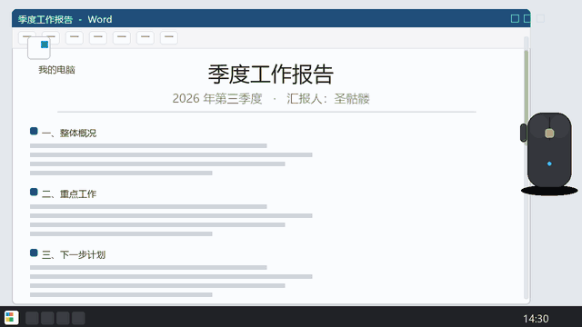

# 桌面切换工具（Desktop Switcher）v1.3.2

一个藏在托盘里的小工具：**单击快捷键在工作/摸鱼虚拟桌面之间来回切换，双击回到工作桌面并把默认浏览器切到第一个标签页（也可自定义打开程序/执行快捷键），长按可以把窗口瞬间藏起来**。免安装、无额外依赖。

程序基于 AutoHotkey v2 开发

## 功能

- **单击快捷键**：在 工作桌面 和 摸鱼桌面 之间来回切换（另一个桌面不存在会自动新建）
- **双击快捷键**：切回 工作桌面，执行自定义动作（默认：把默认浏览器切到第一个标签页；可自定义：打开指定程序 / 执行快捷键指令）
- **长按（判定时间可调，默认 250ms 起）**：完全隐藏当前窗口（从屏幕和任务栏一起消失，真的看不见），再长按一次放出来；恢复时保持藏之前的样子（最大化的还是最大化）
- **离开摸鱼桌面操作**（托盘二级菜单，两个开关互相独立）：
  - **系统静音**：离开摸鱼时自动禁音，回摸鱼自动恢复；用系统 API 静音，**不会弹音量提示条**；开着主流游戏（英雄联盟/PUBG/原神等）也一并静音
  - **播放暂停**：暂停正在放音视频的播放器或浏览器（浏览器发媒体命令，播放器发系统媒体键）；暂停后不自动恢复播放
  - **只对摸鱼桌面生效**：工作桌面放的视频不会被误暂停/静音，完全不打扰你工作
- **双击 / 长按 = 紧急回避**：不管在哪个桌面，只要按了就立刻按上面两个开关执行静音+暂停（突然被发现时一键收敛声音画面）
- **托盘右键菜单**：修改快捷键、执行速度延迟、设定工作桌面、双击后工作桌面打开窗口（自定义）、离开摸鱼桌面操作、长按快捷键隐藏方式（隐藏多个窗口 / 管理已隐藏窗口 / 释放所有）、开关开机自启、获取权限、更多（使用说明）、退出
- **快捷键设置很人性化**：显示为 `LCtrl+Num*` 这样看得懂的形式，自动区分左右修饰键
- **DLL 已内嵌**：不需要额外放任何 DLL 文件，运行时会自动释放使用

## 使用

### 运行
- **exe 版**：双击 `桌面切换工具V1.3.2.exe`

运行后任务栏右下角会出现托盘图标，程序常驻后台。

### 快捷键（默认）

| 操作 | 效果 |
|---|---|
| 单击 `LCtrl+Num*` | 在 工作桌面 ⇄ 摸鱼桌面 之间切换；离开摸鱼时按托盘开关静音/暂停摸鱼桌面的媒体 |
| 双击 `LCtrl+Num*` | 切回 工作桌面，并把默认浏览器切到第一个标签页（或按自定义动作执行）；同时紧急静音/暂停 |
| 长按 `LCtrl+Num*` | 隐藏当前窗口（紧急静音/暂停）；再长按一次放出来（静默，无提示） |

### 工作桌面 / 摸鱼桌面

- 托盘右键 →「设定工作桌面」→ 选「桌面1 是工作桌面」或「桌面2 是工作桌面」，另一个自动就是摸鱼桌面
- 设定会记住，重启后依然有效
- 单击/双击都以工作桌面为基准：离开摸鱼 = 去工作，离开工作 = 去摸鱼

### 双击后工作桌面打开窗口（自定义）

托盘右键 →「双击后工作桌面打开窗口...」二级菜单：

- **选择程序**：选择电脑里任意程序/文件，双击后自动执行——程序已在**工作桌面**打开 → 直接聚焦置前；工作桌面没有 → 打开一个新窗口（**绝不会跳到摸鱼桌面去聚焦**）
- **执行快捷键指令**：录制一个快捷键组合，双击后在切回工作桌面时自动执行（支持「不设定」按钮清空恢复未设置；按弹窗右上角 X 即停止录制）
- **执行快捷键延迟**：切回工作桌面后，等多少毫秒再执行快捷键指令（0~3000，默认 300）
- **恢复默认**：清空程序/快捷键设定，回到「默认浏览器第一标签」方案

### 长按快捷键隐藏方式

托盘右键 →「长按快捷键隐藏方式...」二级菜单：

| 菜单项 | 作用 |
|---|---|
| 隐藏多个窗口 | 默认**关**：长按藏一个、再长按放回；打开后可连续隐藏多个窗口，长按永远藏当前焦点窗口 |
| 管理已隐藏窗口... | 弹出列表显示当前已隐藏的窗口（进程名+标题），可**单击单个释放**，列表底部也有「释放所有隐藏窗口」；窗口位置可拖动，关闭后记住位置 |
| 释放所有隐藏窗口 | 兜底：一键恢复所有没放出来的窗口 |

- 长按隐藏会自动排除**桌面、任务栏、开始菜单、本程序自己的弹框**等不该藏的元素
- 关闭脚本/退出程序时，所有未释放的隐藏窗口会自动全部放出来，不会丢窗口

### 离开摸鱼桌面操作（静音 / 播放暂停）

托盘右键 →「离开摸鱼桌面操作...」二级菜单：

| 开关 | 作用 |
|---|---|
| 系统静音 | 离开摸鱼时自动禁音，回摸鱼自动恢复（默认关，可开）；开着游戏也静音 |
| 播放暂停 | 单击离开摸鱼 / 双击 / 长按隐藏时，暂停正在放音视频的播放器或浏览器（默认开） |

暂停方式说明：

- **浏览器**（Edge/Chrome/豆包浏览器/Firefox 等）：发送系统媒体暂停命令（浏览器不吃系统媒体键，发的是兼容的媒体消息）
- **播放器**（PotPlayer/VLC/mpc-hc 等）：发系统键盘媒体「播放/暂停」键
- **游戏**：不发暂停命令（暂停游戏会出问题），只做系统静音；游戏名单见脚本内 `gameList`，可自行追加

### 开机启动（计划任务模式）

托盘右键 →「开机启动」：勾选后登录时**自动以管理员权限运行**（开机就拿到完整权限，任务栏/任务管理器上的快捷键也有效）。

- 采用**计划任务**实现（而非注册表启动项），登录延迟约 20 秒后启动，托盘图标稍晚出现属正常
- **无任何弹窗**：任务通过 `conhost --headless` 无窗口方式启动，不会闪黑框
- **自动选择最新版本**：任务按通配符自动启动同目录最新的 `桌面切换工具V*.ahk`（或封装后的 `V*.exe`），自动排除备份文件
- **改名 / 移动目录后依然有效**：脚本启动时会自动检测任务指向并重建，无需手动处理
- **开关有约 3~5 秒等待**：需要提权注册/删除计划任务（UAC），属正常开销

### 获取权限

托盘右键 →「获取权限」：勾选表示当前**已以管理员权限运行**；未勾选时点一下会弹 UAC，确认后以管理员权限重启程序（热键在任务管理器/任务栏等权限窗口上也能生效）。

### 修改快捷键

右键托盘图标 → 点「修改快捷键」→ 按下新的组合键即可，改动会记住，下次启动仍然有效。

支持：

- 键盘键 + 修饰键，**区分左右**（`LCtrl` / `RCtrl` / `LAlt` / `RAlt` / `LShift` / `RShift` / `LWin` / `RWin`），Win 键保持独立
- 鼠标**中键**（`MButton`）、**侧键**（`XButton1` / `XButton2`）
- 触发方式：按住修饰键不放连按主键、或修饰键和主键一起按下都可以
- 不支持滚轮键；录制时按 `Esc` 取消，或点弹窗右上角 X 直接停止录制

### 执行速度延迟

右键托盘图标 → 点「执行速度延迟」→ 填一个数字（150~1000 毫秒），点确定立即生效并记住。

这是"单击/双击"的判定时间：调大双击更好按（但单击响应稍慢），调小单击更跟手。填 1 会自动变成 150。

## 托盘菜单

| 菜单项 | 作用 |
|---|---|
| 修改快捷键（当前值） | 录制新的快捷键 |
| 执行速度延迟（当前值） | 调整单击/双击判定时间（150~1000 毫秒） |
| 设定工作桌面（当前值） | 选 桌面1/桌面2 为工作桌面，另一个是摸鱼桌面 |
| 双击后工作桌面打开窗口... | 自定义双击动作：选程序 / 执行快捷键指令 / 延迟 / 恢复默认 |
| 长按快捷键隐藏方式... | 隐藏多个窗口开关 / 管理已隐藏窗口 / 释放所有隐藏窗口 |
| 离开摸鱼桌面操作... | 「系统静音」「播放暂停」两个独立开关 |
| 开机启动 | 开关计划任务开机自启（登录以管理员运行，状态会记住） |
| 获取权限 | 检测/获取管理员权限（勾选=已是管理员） |
| 更多 → 使用说明 | 弹出简明操作说明（含软件更新/开源链接、作者） |
| 退出 | 退出程序（已隐藏的窗口会自动全部放出） |

## 常见问题

**Q：任务管理器/任务栏打开时，快捷键没反应？**
这是 Windows 的安全机制（UIPI）：任务管理器是管理员权限窗口，非管理员进程读不到它的键盘输入，任何工具（PowerToys 等）都一样。用完后点一下桌面或普通窗口再按快捷键即可。**要完全解决：托盘「获取权限」或以管理员权限运行**（开机启动默认就是管理员运行，所以重启后不会遇到这个问题）。

**Q：英雄联盟等全屏游戏里快捷键没反应？**
全屏独占模式下系统虚拟桌面热键会被游戏屏蔽。在游戏内把显示模式改成「无边框窗口」即可正常切换。

**Q：Edge 隐藏后重新唤出，双击和 Ctrl+1 没反应？**
已知的浏览器（Chromium 内核）兼容问题：Edge 被完全隐藏再唤出后，键盘输入会暂时失灵（手动 Ctrl+1 也没用），**用鼠标点一下 Edge 页面任意位置就恢复**。记事本等普通窗口没有这个问题。暂时没有自动修复方案，后续版本再看。

**Q：需要放 DLL 文件吗？**
不需要。VirtualDesktopAccessor.dll 已以 base64 形式内嵌进脚本/exe，运行时自动释放到临时目录并加载。

**Q：默认浏览器怎么识别？**
通过注册表查询系统默认浏览器（http 关联），识别失败时回退到 Microsoft Edge。

**Q：脚本改名或换目录后，开机自启还能用吗？**
能。开机自启任务是"通配符 + 同目录"方式：自动启动**当前脚本所在目录**里最新版本的 `桌面切换工具V*.ahk`（或 exe），不绑定固定文件名。改名/移动后首次启动会自动重建任务指向，无需手动操作。

**Q：封装成 EXE 后，开机自启和提权还正常吗？**
正常。脚本会自动识别运行形态：以 .ahk 运行 → 自启启动最新 .ahk；封装成 EXE 运行 → 自启启动最新 .exe。「获取权限」的 UAC 提权不依赖运行形态，两种形态都有效。

## 技术说明

- 作者：圣骷髅
- 语言/运行时：AutoHotkey v2
- 虚拟桌面控制：VirtualDesktopAccessor（内嵌）
- 开机自启：计划任务（conhost --headless 无窗口启动 + 内联 PowerShell 通配选择最新版本，**不生成任何启动器文件**）
- 配置：`桌面切换.ini`（与脚本同目录，记录快捷键、执行速度延迟、开机自启、工作桌面与各开关状态）

## 版本历史

### v1.3.2（2026-10-18）

- **新增**：开机自启改为**计划任务模式**，登录即以管理员权限运行（开机就拿到完整权限）
- **新增**：托盘「获取权限」菜单，一键检测/获取管理员权限
- **新增**：开机自启任务内联 PowerShell 通配启动同目录最新脚本，改名/剪切目录后仍有效
- **新增**：开机自启自动选择最新版本，**排除备份文件**（`V*_备份_*` 不会被误启动）
- **优化**：脚本整体精简（SetAutoStart 注释与代码更新、重复代码合并）

### v1.3.1（2026-10-12）

- **修复**：切换桌面时任务栏图标闪烁（改模拟系统热键切换，与手动 Win+Ctrl+方向键一致）
- **修复**：后台窗口扫描的竞态报错（窗口在遍历瞬间被关闭导致弹窗）
- **优化**：单击的静音/暂停只对摸鱼桌面生效，工作桌面的视频不再被误操作
- **优化**：双击/长按 = 紧急回避，任何桌面按下都执行已勾选的静音+暂停
- **优化**：系统静音改用系统 API（不再弹屏幕中下方音量提示条）；开着主流游戏切走自动静音
- **优化**：暂停后不自动恢复播放；浏览器/播放器暂停方式区分（浏览器媒体消息、播放器媒体键）
- **优化**：脚本整体精简排序（配置读取统一、全局变量集中、窗口遍历加固）

### v1.3.0（2026-10-07）

- **新增**：双击后工作桌面打开窗口自定义（选择程序 / 执行快捷键指令 / 执行快捷键延迟 / 恢复默认），程序已打开则聚焦、未打开才新建
- **新增**：托盘「离开摸鱼桌面操作...」二级菜单，「系统静音」与「播放暂停」独立开关
- **新增**：播放暂停功能——离开摸鱼/隐藏窗口时暂停播放器或浏览器的音视频
- **优化**：托盘菜单分组、使用说明界面美化（白底样式 + 软件更新/开源链接）
- **优化**：脚本结构精简（气泡提示统一、删除冗余）

### v1.2（2026-09-29）

- **新增**：工作桌面 / 摸鱼桌面 概念，托盘可设定并记忆
- **新增**：离开摸鱼自动静音（可关闭）、双击/长按的音视频静音联动
- **新增**：托盘「释放所有隐藏窗口」兜底按钮
- **优化**：托盘菜单分组美化，「更多」子菜单收纳低频项

### v1.1（2026-09-28）

- **新增**：长按 350ms 隐藏/恢复当前窗口（完全隐藏、静默、恢复保持最大化状态）
- **新增**：托盘菜单「执行速度延迟」，单击/双击判定时间可调

### v1.0（2026-09-28）

- 首个发布版：单击切桌面 / 双击回桌面1 并切浏览器第一个标签
- 托盘菜单：修改快捷键（区分左右键）、开机启动、使用说明、退出
- DLL 内嵌单文件，免额外依赖
